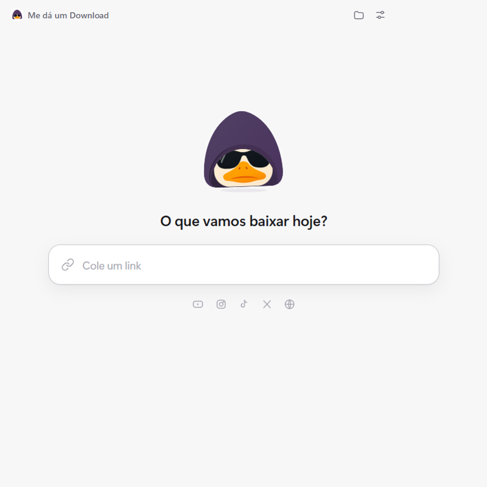
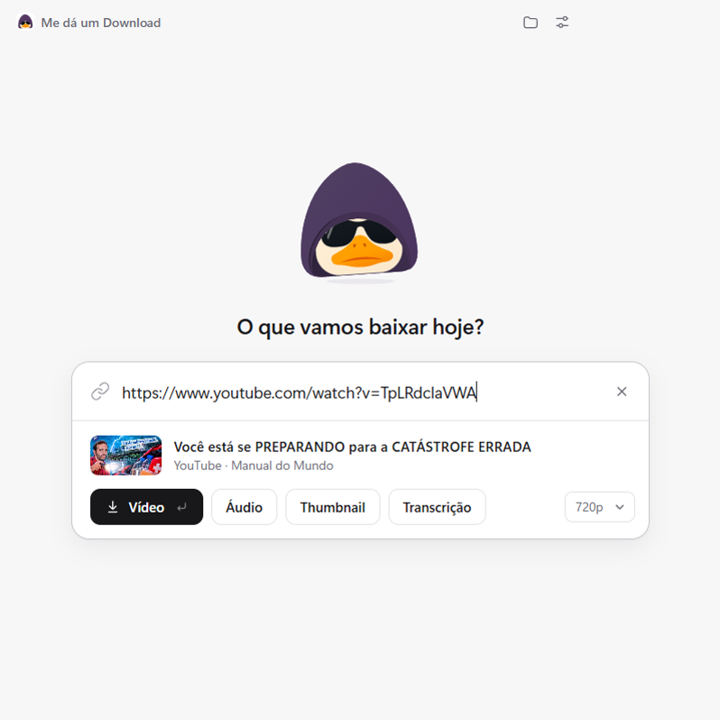

# Me dá um Download

Cola o link, baixa. Um app para Windows que baixa vídeos, áudio, fotos e
transcrições do YouTube, Instagram, TikTok, X e de mais de mil outros sites,
com uma tela só: um campo para o link.



O app reconhece de qual rede é o link e que tipo de conteúdo ele tem, e já
mostra as ações que fazem sentido:



## O que ele baixa

| Rede | O que dá para baixar |
|---|---|
| YouTube | Vídeo (até a qualidade máxima), áudio em MP3, thumbnail, playlist inteira e transcrição |
| Instagram | Reels, posts e carrosséis (fotos e vídeos). Com login: stories, destaques e foto de perfil |
| TikTok | Vídeo, áudio, carrossel de fotos e transcrição |
| X (Twitter) | Vídeos e fotos de um post |
| Outros | Facebook, Reddit, Pinterest, Vimeo, Twitch, SoundCloud, Bluesky e qualquer site que o yt-dlp conheça |

## Instalar

Baixe o instalador mais recente na página de
[Releases](../../releases/latest) e execute.

O instalador não é assinado digitalmente, então o Windows mostra um aviso do
SmartScreen. Clique em **Mais informações** e depois em **Executar assim
mesmo**.

Na primeira abertura o app baixa o yt-dlp (cerca de 23 MB), então é preciso
estar conectado à internet.

## Como usar

- Copie um link e abra o app: ele já aparece no campo. Também dá para colar
  com `Ctrl+V` em qualquer lugar da janela ou arrastar o link para ela.
- `Enter` dispara a ação principal; `Esc` limpa o campo.
- Clicar num download concluído abre o arquivo. Arrastar a linha leva o
  arquivo direto para outro programa.
- Fechar a janela manda o app para a bandeja e os downloads continuam. Para
  sair de verdade, use **Sair** no menu do ícone da bandeja.

Nos ajustes (ícone no topo) ficam a pasta de destino, a qualidade padrão, a
opção de abrir a pasta quando um download termina, o Whisper e a conexão com
o Instagram.

## Transcrição

O botão **Transcrição** gera dois arquivos: um `.txt` com o texto em
parágrafos e um `.srt` com os tempos, para usar como legenda.

- **YouTube:** usa a legenda do próprio YouTube, no idioma original do vídeo.
  Sai em poucos segundos, sem baixar o vídeo.
- **TikTok:** usa a legenda automática do TikTok, quando o vídeo tem.
- **Reels e vídeos sem legenda:** usam o Whisper, que transcreve o áudio no
  próprio computador.

### Whisper (opcional)

O Whisper é opcional. Sem ele, todo o resto do app funciona igual; só não é
possível transcrever vídeos que não têm legenda pronta.

Ao abrir, o app procura nesta ordem:

1. o [faster-whisper](https://github.com/SYSTRAN/faster-whisper) instalado no
   Python do computador, com algum modelo já baixado (usa a placa de vídeo
   quando há uma compatível);
2. o [whisper.cpp](https://github.com/ggml-org/whisper.cpp) baixado
   anteriormente pelo próprio app.

Se não encontrar nenhum, ele pergunta uma vez se você quer baixar o
whisper.cpp com o modelo (cerca de 556 MB). Dá para recusar e baixar depois
pelos ajustes.

## Instagram com login

O Instagram não entrega stories, destaques, foto de perfil e algumas fotos
para quem não está logado. Para esses casos o app oferece **Conectar
Instagram**, que abre a tela de login oficial dentro do app. A senha é
digitada na página do próprio Instagram; o app só reaproveita a sessão, que
fica guardada no seu computador.

Automatizar o acesso pode levar o Instagram a restringir a conta. Considere
usar uma conta secundária.

## Limitações conhecidas

- O TikTok bloqueia consultas automatizadas de tempos em tempos. O app tenta
  de novo sozinho, mas às vezes é preciso repetir.
- Sem login, o Instagram às vezes não libera fotos avulsas.
- Os recursos do Instagram que dependem de login e a instalação do Whisper
  pelo app (whisper.cpp) foram escritos mas ainda não passaram por teste
  completo. Se algo falhar, o motivo fica registrado em
  `%APPDATA%\MeDaUmDownload\falhas.log`.
- Só há versão para Windows 10 e 11 de 64 bits.

## Como funciona

O app é feito em [Electron](https://www.electronjs.org/) e combina três
motores, escolhendo o melhor para cada link e caindo para o seguinte quando
um falha:

- **[yt-dlp](https://github.com/yt-dlp/yt-dlp):** YouTube e os demais sites.
  É baixado na primeira abertura e se atualiza sozinho uma vez por dia.
- **[Cobalt](https://github.com/imputnet/cobalt):** Instagram, TikTok, X e
  outros, incluindo fotos e carrosséis. Roda como um servidor local, só nesta
  máquina, embutido no app.
- **Módulo próprio do Instagram:** stories, destaques, foto de perfil e posts
  quando há login.

## Rodar a partir do código

Requisitos: Windows, [Node.js](https://nodejs.org/) 22.12 ou mais novo e git.

```bash
npm install
```

```bash
npm run setup
```

```bash
npm start
```

O `npm run setup` baixa o Cobalt para `vendor/cobalt` e aplica um ajuste
pequeno para ele rodar dentro do Electron (descrito em
[scripts/setup-cobalt.mjs](scripts/setup-cobalt.mjs)).

Para gerar o instalador em `dist/`:

```bash
npm run dist
```

## Uso responsável

Baixe apenas conteúdo que você tem direito de baixar. Respeite os direitos
autorais e os termos de uso de cada plataforma.

## Licença e créditos

O código deste repositório é distribuído sob a licença
[AGPL-3.0](LICENSE).

O mascote (o ganso) e o ícone do app são marca do autor e **não** fazem parte
dessa licença: não os reutilize em outros projetos sem autorização.

O instalador inclui ou baixa programas de terceiros, cada um com a sua
licença:

| Projeto | Licença | Como é usado |
|---|---|---|
| [Cobalt](https://github.com/imputnet/cobalt) | AGPL-3.0 | Incluído no instalador, com o ajuste descrito em `scripts/setup-cobalt.mjs` |
| [FFmpeg](https://ffmpeg.org/) | GPL-3.0 | Incluído no instalador, via [ffmpeg-static](https://github.com/eugeneware/ffmpeg-static) |
| [yt-dlp](https://github.com/yt-dlp/yt-dlp) | Unlicense | Baixado pelo app na primeira abertura |
| [Electron](https://github.com/electron/electron) | MIT | Base do app |
| [whisper.cpp](https://github.com/ggml-org/whisper.cpp) | MIT | Opcional, baixado só se você aceitar |
| [faster-whisper](https://github.com/SYSTRAN/faster-whisper) | MIT | Opcional, usado se já estiver instalado |
